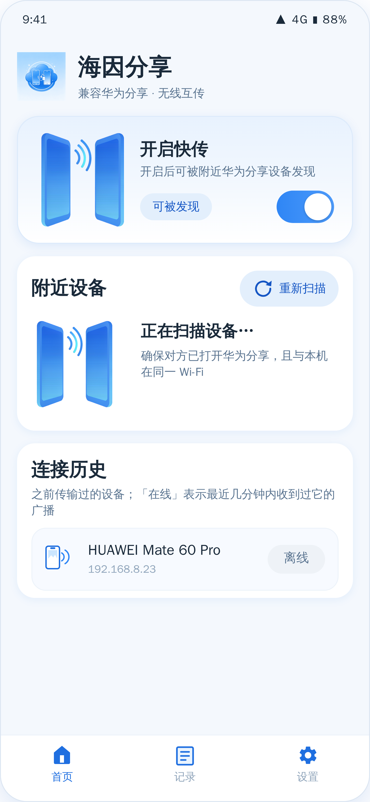
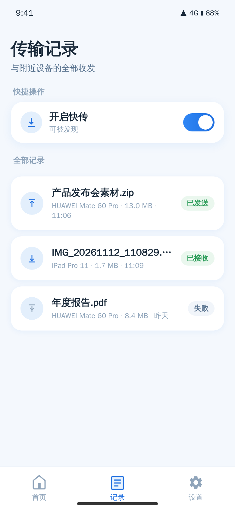
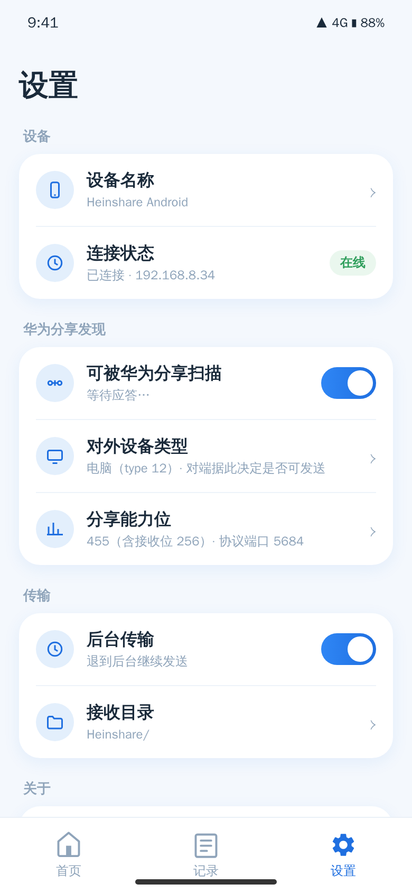
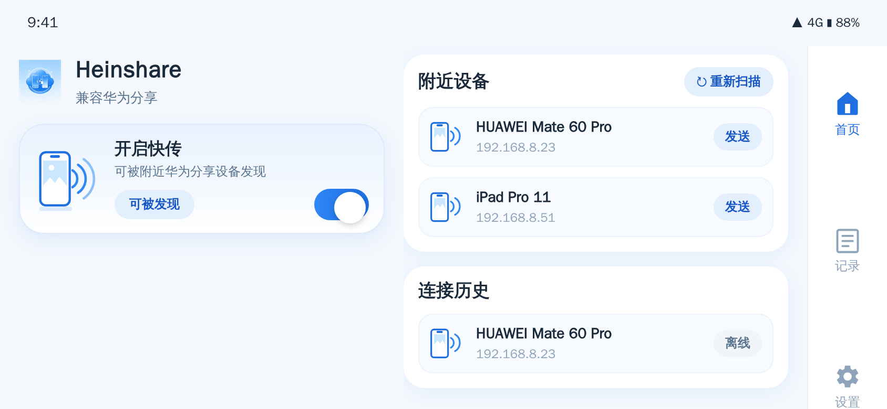
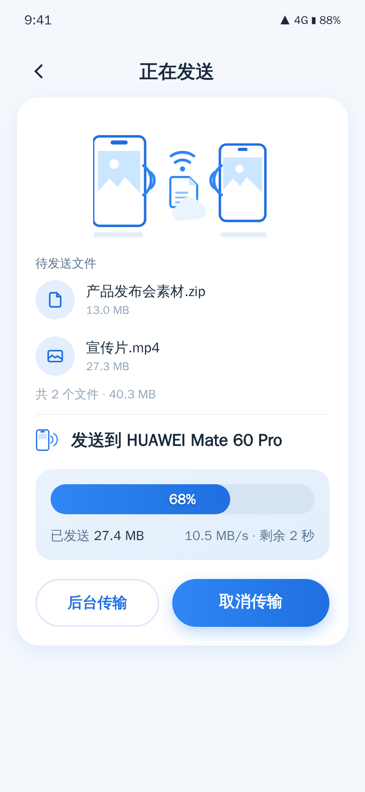
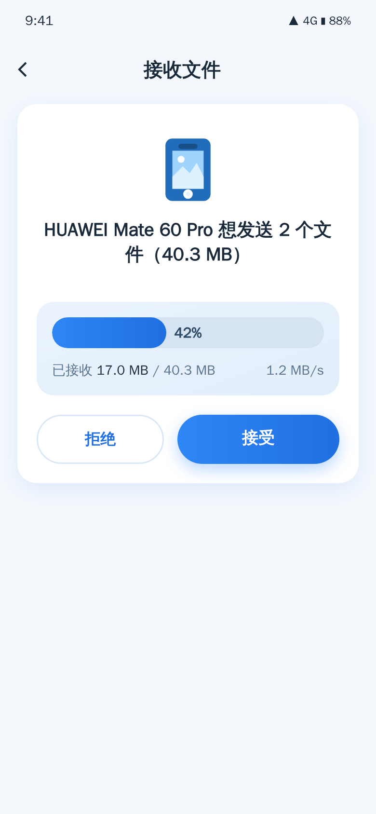

# 海因分享（heinshare）· Android 端

在 Android 手机上，与 **华为设备**、**Windows 版 HiShare** 之间**双向**互传文件。

| 组合 | 状态 |
|---|---|
| **安卓 → 华为设备**（手机 / 平板 / 鸿蒙） | 支持。华为端直接用系统「华为分享」接收 |
| **华为设备 → 安卓** | 支持。华为端「华为分享」里能扫到本机并选中发送 |
| **安卓 → Windows 版 HiShare** | 支持。两端同一套协议，直接互传 |
| **Windows 版 HiShare → 安卓** | 支持。同上，反向 |

不需要装助手客户端、不需要登录、不需要云盘中转 —— 走的是局域网直连，打开手机的「华为分享」，
本机就能出现在可发送目标列表里。

> **Windows 端可以直接使用原作者的软件**：Windows 电脑侧运行原作者
> HiShare（Rust 版）即可与安卓端互传，无需本仓库另出 Windows 包。
> 原项目仓库：<https://github.com/SoulLinkIly/HiShare>
> 本仓库只分发安卓端代码。

<p align="center">
  
  
  
</p>

---

## 功能总览

### 双向互传

| 方向 | 说明 |
|---|---|
| **安卓 → 华为设备** | 在 App 内选好文件、确认清单后一次发出；华为手机端会弹出「接收文件」提示 |
| **华为设备 → 安卓** | 华为手机「华为分享」里扫到本机、选中本机发送，本机弹窗确认后接收，自动落盘 |
| **安卓 → Windows HiShare** | Windows 电脑上跑原作者的 `hishare.exe` 监听，两端同为一套协议，直接互传 |
| **Windows HiShare → 安卓** | 同上，Windows 端选到本机发送，本机弹窗确认后接收 |

支持**单文件、多文件、整个文件夹**（保留目录结构）一次发。接收侧同样支持多文件。

### 选文件与发送

- 选文件直接调**系统文件管理器**，选完在 App 内**确认清单**（带真实文件图标和大小）再发，避免误选
- 发送页实时显示：进度百分比、已传字节、瞬时速度、剩余时间
- 支持**后台传输**：退到后台或锁屏后继续发，通知栏常驻进度
- 发送失败可**重试**，并给出「确认对方已打开华为分享」这类可操作的提示

### 接收与落盘

- 收到的文件默认落到系统「下载」/ `Heinshare/`，**API 29+ 走 MediaStore，不需要任何存储权限**
- 接收目录三选一：系统「下载」/ 应用私有目录（无需权限）/ 用系统目录选择器指定的**任意目录**
- 接收完成后自动写传输记录
- 记录页「**已接收的文件**」列出历史接收的每个文件，**点一下直接用系统应用打开**

### 设备发现

- 首页「**开启快传**」一开即可被附近华为分享设备发现；开关同时是前台服务的总开关，关掉即彻底停止广播
- 首页有「**重新扫描**」按钮，**不用干等自动刷新**
- 「**连接历史**」记住之前传输过的设备，并标注**在线 / 离线**（最近几分钟内收到过它的广播即为在线）
- 未连 Wi-Fi 时首页顶部给出黄色提示条（此时华为分享扫不到本机）

### 传输记录

- 所有收发按时间倒序留档：文件名、对端、大小、时间、状态（已发送 / 已接收 / 失败）
- 记录页顶部有快传开关快捷入口
- 下方「**已接收的文件**」是历史接收清单（文件名 + 位置 + 时间），**点一行直接打开那个文件**

### 界面

- **首页 / 记录 / 设置** 三页底部导航
- **横屏两栏**：左栏品牌 + 开关卡，右栏设备列表，**两栏各自独立滚动**，长列表不会够不着底
- 竖屏、横屏都有独立布局，导航在横屏时改为右侧竖排，把屏幕高度全留给内容
- 全部图标为**静态矢量图**，无动画

### 检查更新

- 启动时**自动检查一次**，**每天只查一次**（记录在本地，当天不再重复）
- 设置页「**检查更新**」可随时手动检查
- 更新源是 GitHub 仓库的 **Release**：比较 **tag 版本号**（`1.0.0` 写法，不带 `v`）
- 发现新版本后弹窗提示，可**直接下载 APK 并调起安装**，也可跳到 Release 页面

### 关于与仓库

- 设置页「**项目仓库**」一键打开 <https://github.com/hein1225/HeinShare>
- 如果「海因分享」对你有帮助，欢迎给仓库点个 **Star ⭐**
- 本项目在此基础上二次开发，**原 Windows 版 HiShare（Rust）仓库**：<https://github.com/SoulLinkIly/HiShare>

### 海因软件分享

设置页新增「**海因软件分享**」区块，点开任一条目会弹出简介与仓库地址，可一键跳转到 GitHub：

| 软件 | 仓库地址 | 简介 |
|---|---|---|
| 海因影视 | <https://github.com/hein1225/HeinPlay> | 影视播放与管理工具，本地片库整理、播放记录与多端访问 |
| 海因成长助手 | <https://github.com/hein1225/Height4Kid> | 记录孩子的成长过程，相册、身高体重与成长里程碑的持续留存 |

### 兼容性

- Android 7.0（API 24）及以上
- 对外宣称身份是 **`type=12`（电脑）** —— 华为手机把本机当成「可接收分享的电脑」时，才会把本机列进可发送目标；宣称成手机反而可能被对端当同类设备过滤掉
- 协议层与 Windows 版 HiShare **逐字段一致**

<p align="center">
  
</p>

---

## 界面一览

### 首页 · 竖屏

品牌区 + 「开启快传」开关卡 + 附近设备（带「重新扫描」）+ 连接历史（在线 / 离线）。

<p align="center"></p>

### 首页 · 横屏两栏

左栏品牌与开关卡，右栏设备列表与连接历史，两栏独立滚动；底部导航改为右侧竖排。

<p align="center"></p>

### 正在发送

顶部设备互传插图 → 待发送文件清单 → 目标设备 → 进度面板（进度条 / 速度 / 剩余时间）→ 后台传输 / 取消传输。

<p align="center"></p>

### 接收文件

对端设备图标 + 「想发送 N 个文件（多大）」→ 接受 / 拒绝 → 接收进度与速度。

<p align="center"></p>

### 传输记录

快传开关快捷入口 + 全部收发记录（文件名 / 对端 / 大小 / 时间 / 状态）。

<p align="center"></p>

### 设置

设备名称、连接状态、**可被华为分享扫描**开关、对外设备类型、分享能力位、后台传输开关、接收目录、版本号、**检查更新**、**项目仓库**（含求 Star 提示）。

<p align="center"></p>

---

## 仓库结构

```
android/            安卓工程（Kotlin）
  core/             协议层：发现 / 握手加密 / 数据通道
  app/              界面层：三页 + 底部导航
  core/src/test/    协议与密码学单元测试
  app/src/test/     更新检查等界面层单元测试
.github/workflows/ GitHub Actions：手动填 tag 构建并发布 Release
docs/screenshots/   README 用界面截图
docs/shots-src/     截图生成源（HTML + VectorDrawable→SVG 转换脚本）
port-spec/          逐字节协议规格（发现 / 握手加密 / 数据通道）
plan/               设计稿、工作报告、Windows 参照工程
```

安卓端的协议层以 Windows 版 HiShare（Rust 实现）的协议为蓝本移植而来，
`android/core` 与之逐字段对齐；本仓库只分发安卓端代码。

---

## 快速开始

环境要求：JDK 17、Android SDK platform 34 + build-tools 34.0.0、Gradle 8.7（wrapper 自动下载）。

```bash
export JAVA_HOME=<你的 JDK 17 目录>
export ANDROID_HOME=<你的 Android SDK 目录>
export PATH="$JAVA_HOME/bin:$ANDROID_HOME/platform-tools:$PATH"

cd android
./gradlew :app:assembleDebug      # 调试包 app/build/outputs/apk/debug/app-debug.apk
./gradlew :app:assembleRelease    # 正式包 app/build/outputs/apk/release/app-release.apk
./gradlew :core:testDebugUnitTest # 密码学 / 协议单元测试
```

首次构建需要联网拉取 Gradle 与 Maven 依赖；工程已配置国内镜像加速。
正式包签名参数通过 `-Pheinshare.keystore=/path/to/keystore.properties` 或环境变量
`HISHARE_KEYSTORE_PROPERTIES` 指定，不配置则产出未签名包。版本号可用
`-PversionName=1.0.0` 覆盖（默认 1.0.0，不带 `v`）。详见
[`android/构建说明.md`](android/构建说明.md)。

安装后打开 App，首页「开启快传」打开即可对外广播。设备名、接收目录在设置页改。

### 在线构建与发布

仓库内置 GitHub Actions 工作流 `.github/workflows/release.yml`：

1. 在 **Actions → Build & Release → Run workflow** 里填 **tag 版本号**（不带 `v`，例如 `1.0.0`）
2. 可选填更新日志；留空则**按本次提交自动生成**
3. 工作流构建 release APK（签名密钥通过 Secrets `KEYSTORE_BASE64` / `KEYSTORE_PASSWORD` /
   `KEY_ALIAS` / `KEY_PASSWORD` 提供），随后创建 **Release 名为 `HeinShare-<tag>`**（例如
   `HeinShare-1.0.0`）的发布，并把 APK 作为附件上传

App 的检查更新正是读这个 Release 的 tag 与 APK 附件。

**包名**：`com.heinshare.app`。改名自早期版本（`com.hishare.android`），两个包名**不能互相覆盖**，
升级前请先卸载旧版。

---

## 协议要点

| 项 | 值 |
|---|---|
| 发现端口 | UDP 5684（组播 `224.0.0.1` + 广播 `255.255.255.255`） |
| 传输端口 | TCP 5684 |
| `capabilityBitmap` | `[455]`（含接收位 256） |
| 帧头 magic | `0xBABEFACE`（小端），24 字节头 |
| 加密 | RSA-2048 OAEP / AES-256-GCM / AES-128-GCM（AAD = `DFILE_AAD`）/ ChaCha20-Poly1305 |
| 身份派生 | `device_hash` = hex_upper(HMAC-SHA256(pubDer[0..16], pubDer)[0..8]) |

收到华为发来的查询包**必须立即应答**（同一对端 2 秒一次），解析失败也要应答；
CON 包回 4 字节 ACK。组播锁由前台服务持有，界面上的「可被发现」就是这个能力的对外反馈。

密码协商走能力位 `Protocol.settingsCipherCaps`：`CIPHER_CLEAR=0x1 / CIPHER_CHACHA=0x2 / CIPHER_AES=0x4`。

逐字节细节见 [`port-spec/`](port-spec/)。

---

## 文档导航

| 你想做什么 | 看哪份 |
|---|---|
| 装上就用 | 本文件 + [`android/使用说明.md`](android/使用说明.md) |
| 自己构建 | [`android/构建说明.md`](android/构建说明.md) |
| 打包发布新版本 | GitHub Actions → `Build & Release`（填 tag） |
| 改协议 | [`port-spec/`](port-spec/) |
| 看开发过程 | [`plan/worklogs/`](plan/worklogs/) |

---

## 已知限制

- **不支持断点续传**。中断了要重发（临时文件以 `.part` 结尾）。
- 接收目录可选：应用私有目录 / 系统「下载」目录 / 用户用系统目录选择器指定的任意目录（设置页切换）。
- 只支持 Android 7.0（API 24）及以上。
- 公司网络、访客 Wi-Fi 常开「AP 隔离」，设备之间互相看不见，这种网络下用不了。
- 不支持中途切换目标设备；大文件传输期间保持两台设备在同一网络下。

---

## 说明

> **本项目基于原作者 HiShare 二次修改开发**：以原 Windows 版（Rust 实现）的协议为蓝本，
> 移植并重写为 Android 端（Kotlin），新增移动端界面、媒体选择、前台服务等能力。
> 原项目仓库：<https://github.com/SoulLinkIly/HiShare>
>
> 这是一个**第三方互操作性实现**，与华为、苹果公司没有任何隶属或合作关系。
> 名称仅用于说明它能和谁互通。

「华为分享」「鸿蒙 / HarmonyOS」「华为」「iPad / iPhone」等名称是其各自所有者的商标，
本项目仅用来说明兼容对象，与权利人无隶属、合作或背书关系。
